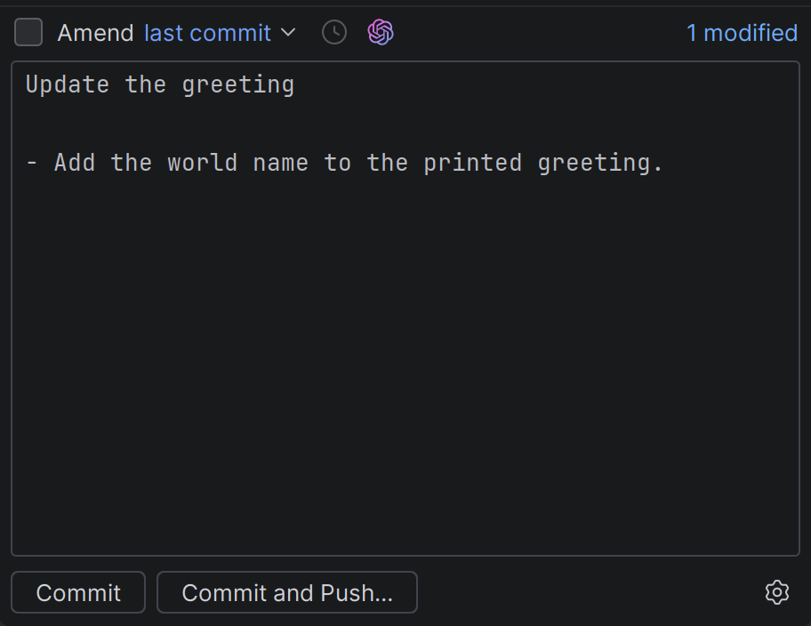

# CodexCommit

This plugin uses Codex in PyCharm to prepare short commit messages from selected Git changes. Select the files, then select the CodexCommit button. The draft appears in the commit message field. Examine it before you commit. The plugin needs a compatible Codex CLI and an active personal account to work.

## Install with Codex

Use **PyCharm 2026.2.3**, native **Codex CLI 0.160.1**, and native **Git** on Windows or Linux.
Use a personal, unmanaged Codex account. The model follows your saved CLI setting or the CLI default.

1. Connect GitHub to Codex. Select [this repository](https://github.com/nvxraM/CodexCommit).
2. Ask Codex:

   > Help me install CodexCommit in PyCharm from github.com/nvxraM/CodexCommit.

Codex guides setup. You install the ZIP in local PyCharm.
Or use [manual installation](#manual-install) below. [Requirements](docs/USAGE.md#requirements).

## Use

1. Open **Commit**. Select complete tracked file changes in one changelist.
2. Select the coloured **Generate Commit Message with CodexCommit** button.

3. Wait for the draft in the commit message box. Edit it if necessary. Make the commit yourself.

One click. No review windows. The prompt requests a short subject and 1–3 brief bullet points.
Keep `.idea/workspace.xml` checked if needed. Its contents stay out of generation.

Screens use sample data. Select the draft image to enlarge it.
The button sends selected code to OpenAI. Check for private data and secrets first.
Requests can use quota or incur charges. Cancel from the IDE background task control.

## Manual install

1. [Download version 1.1.5](https://github.com/nvxraM/CodexCommit/blob/v1.1.5/releases/CodexCommit-1.1.5.zip?raw=true).
2. In PyCharm, open **Settings → Plugins → ⚙ → Install Plugin from Disk**.
3. Select the ZIP. Restart the IDE if requested.

[User guide](docs/USAGE.md) · [Build](docs/BUILD.md) · [Privacy](docs/PRIVACY.md) · [Security](SECURITY.md) · [All guides](docs/README.md)

Independent project. OpenAI and JetBrains do not endorse it. [MIT license](LICENSE).
